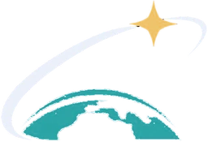
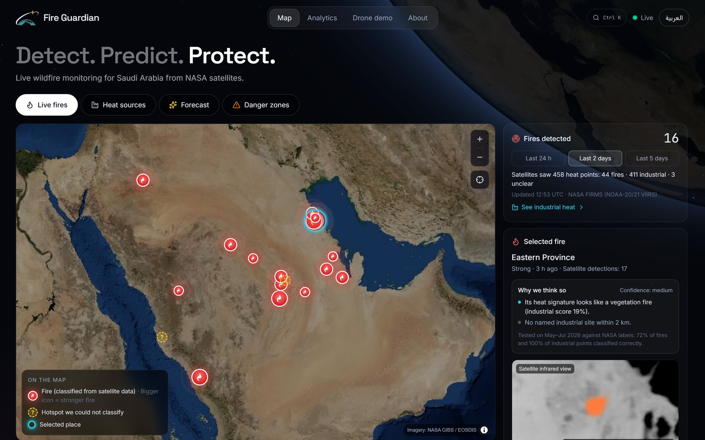
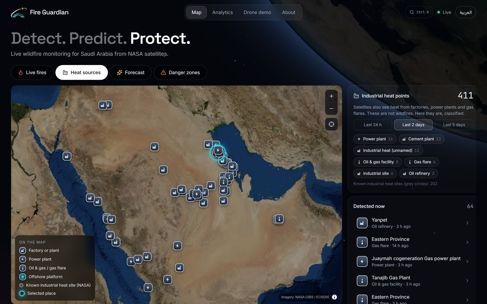
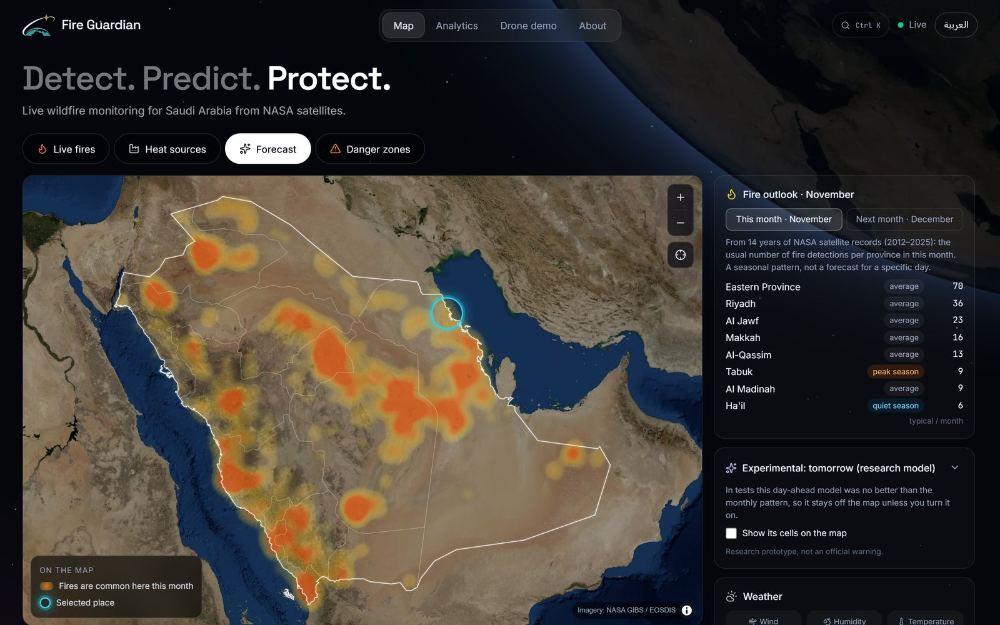
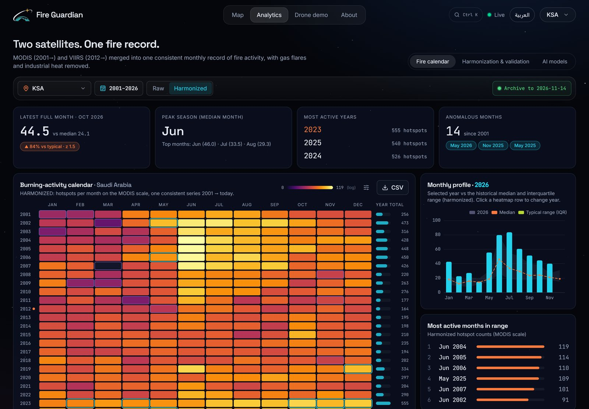
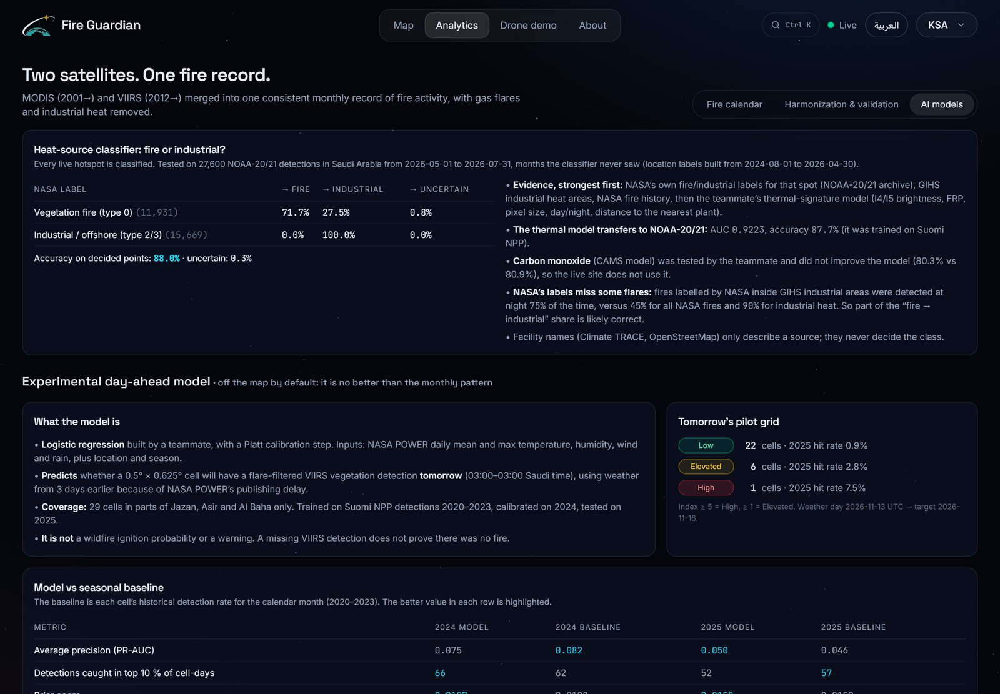
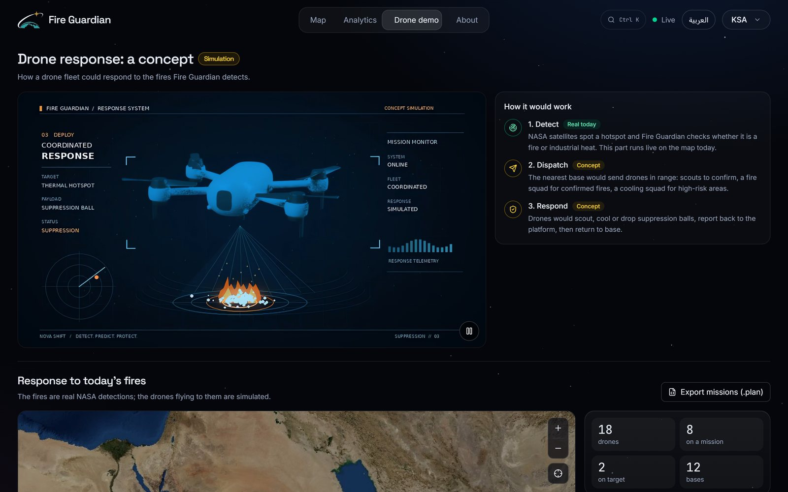
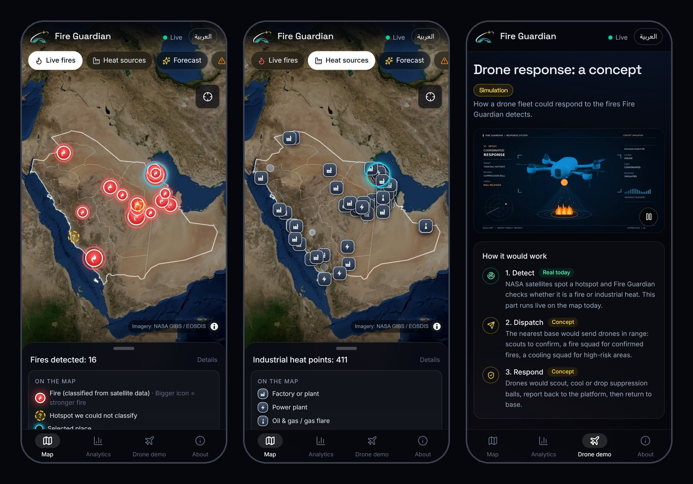
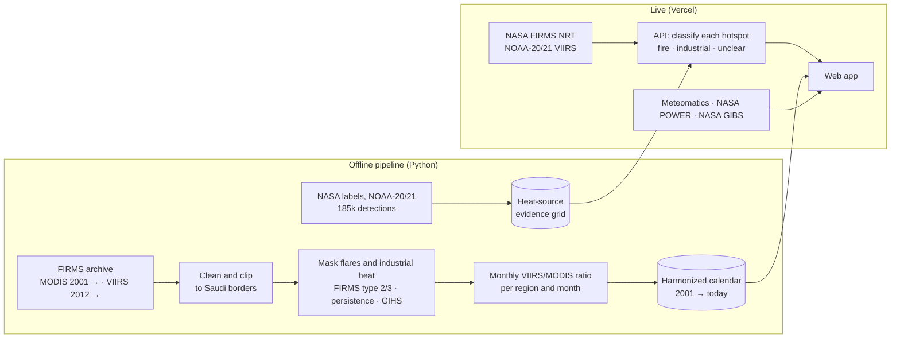

<div align="center">



# Fire Guardian

**Detect. Predict. Protect.**<br/>
Wildfire monitoring for Saudi Arabia, built on one consistent NASA MODIS + VIIRS fire record.

### [▶ Open the live app: firegaurd.vercel.app](https://firegaurd.vercel.app)

[](https://firegaurd.vercel.app)
[](https://www.spaceappschallenge.org/)
[](https://firms.modaps.eosdis.nasa.gov/)

Challenge: **Harmonization of MODIS and VIIRS Hot Spots** · Team **NovaShift**

</div>



## The problem

NASA has watched fires from space with **MODIS** (1 km, since 2000) and now with **VIIRS** (375 m, since 2012). The sensors see the world differently. In Saudi Arabia VIIRS records **9.4× more hotspots** than MODIS, because most burning here is small farm and waste fires that 1 km MODIS misses. Splicing the two records together breaks every long-term trend, and MODIS is reaching the end of its mission.

There is a second problem in Saudi Arabia: **most satellite hotspots are not fires at all.** Gas flares, refineries, power plants and factories are hot too. In our test period, **57 %** of NOAA-20/21 detections over the Kingdom were industrial or offshore heat. Treating every hotspot as a fire makes any map or forecast wrong.

## What Fire Guardian does

| | |
|---|---|
| **One fire record, 2001 → today** | MODIS and VIIRS harmonized per region and calendar month, with flares and industrial heat masked out. The record stays valid after MODIS ends. |
| **Fire or factory?** | Every live hotspot is classified as **vegetation fire**, **industrial heat** or **unclear**, using NASA's own labels for that spot, industrial heat inventories and a thermal-signature model. The evidence is shown for each point. |
| **Live map** | NASA FIRMS detections from NOAA-20/21 VIIRS, refreshed every 10 minutes, with satellite infrared imagery and local weather for any selected point. |
| **Monthly outlook** | Where fires are usual this month and next, per province, from 14 years of records. |
| **Drone response concept** | A clearly labelled simulation of how a drone fleet could respond to the fires the platform detects. |

English and Arabic (right-to-left), with a native-feeling phone layout.

## Try it

Open **[firegaurd.vercel.app](https://firegaurd.vercel.app)** and pick what the map shows:

1. **Live fires**: the fires burning now. Tap one to see why it was classified as a fire, its infrared image and the weather there.
2. **Heat sources**: the industrial heat the satellites also see: refineries, power plants, gas flares and offshore platforms.
3. **Forecast**: where fires are common this month and next.
4. **Danger zones**: only fires burning now and places that burn in most years this month.

Then open **Analytics** for the harmonized fire calendar and the model validation, and **Drone demo** for the response concept.

## Screenshots

| Heat sources: fire or factory | Monthly outlook |
|---|---|
|  |  |
| **Harmonized MODIS + VIIRS calendar** | **Model validation** |
|  |  |

| Drone response concept | On a phone |
|---|---|
|  |  |

## Results

### Harmonized MODIS + VIIRS record (Saudi Arabia, flares masked)

| | Saudi Arabia | South-west (Al Baha · Asir · Jazan) |
|---|---|---|
| FIRMS detections → kept after flare and industrial mask | 629,262 → 52,051 | 3,438 |
| VIIRS / MODIS ratio, 2012 → 2026 | **9.4×** | **6.4×** |
| Monthly correlation, MODIS vs VIIRS | r = 0.50 (log 0.69) | r = 0.90 |
| Leave-one-year-out error, **harmonized** | **13.1 %** | **11.1 %** |
| Same error if raw VIIRS were spliced onto MODIS | 878 % | 504 % |

Large-wildfire regions such as Portugal show a ratio near 2.8. Saudi burning is mostly small fires that MODIS misses, which is why the ratio is learned **per region and calendar month**, not as one global factor.

### Fire vs industrial heat classifier

Tested on **27,600** NOAA-20/21 detections from **May–Jul 2026**, months the classifier never saw, against NASA's own fire / industrial labels:

| NASA label | Classified correctly | Left unclear |
|---|---|---|
| Industrial or offshore heat (15,669) | **99.96 %** | 0 % |
| Vegetation fire (11,931) | **72 %** | 0.8 % |
| **All decided points** | **88.0 %** | 0.3 % |

Most of the fires it calls industrial are night-time detections inside known industrial areas, so they are probably gas flares that NASA labelled as fires. The teammate's thermal-signature model, trained on Suomi NPP, transfers to NOAA-20/21 with **AUC 0.92**. Carbon monoxide (CAMS) was tested and did not improve it, so it is not used live.

## How it works



**Harmonization.** Hotspots are cleaned, clipped to the real Saudi borders and stripped of static heat sources in layers: FIRMS type 2/3 labels, ~1 km and ~5 km persistence rules (with a guard that protects seasonal farm burning) and the GIHS industrial heat inventory. For each calendar month *k*, the ratio r<sub>k</sub> = ΣVIIRS<sub>k</sub> / ΣMODIS<sub>k</sub> over the overlap years puts VIIRS on the MODIS scale. Sparse months are shrunk toward the overall ratio. The harmonized value is the mean of the available estimates, never a sum.

**Classification.** Each live hotspot is checked against, strongest evidence first:
1. NASA's own fire / static / offshore labels for that ~500 m spot (Aug 2024 – Jul 2026).
2. GIHS industrial heat polygons.
3. Heat seen at the same spot in 6 or more different months, which a vegetation fire does not do.
4. NASA fire history at that spot.
5. The thermal-signature model (I4/I5 brightness, fire radiative power, pixel size, day/night, distance to the nearest plant), for places with no history.

Facility names from Climate TRACE (157 plants) and OpenStreetMap (2,158 sites) only label a source; they never decide the class.

**Outlook.** For each province and month, the typical number of fire detections over 2012–2025, marked as peak or quiet season. A teammate's day-ahead weather model is included for reference but is off by default, because on the 2025 test it was no better than this monthly pattern.

## Data sources

| Source | Used for |
|---|---|
| [NASA FIRMS](https://firms.modaps.eosdis.nasa.gov/) | MODIS C6.1 and VIIRS C2 archive (record), NOAA-20/21 VIIRS NRT (live), standard-processing labels (classifier evidence and test set) |
| [NASA GIBS](https://www.earthdata.nasa.gov/engage/open-data-services-software/earthdata-developer-portal/gibs-api) | Blue Marble and VIIRS true-colour basemaps, VIIRS infrared imagery |
| [NASA POWER](https://power.larc.nasa.gov/) | Weather inputs for the day-ahead model |
| [GIHS v3.0](https://doi.org/10.5281/zenodo.8308133) | Industrial heat-source polygons (Ma et al. 2024, CC BY 4.0) |
| [Climate TRACE](https://climatetrace.org/) · [OpenStreetMap](https://www.openstreetmap.org/) | Names of industrial facilities (CC BY 4.0 · ODbL) |
| [Meteomatics](https://www.meteomatics.com/) | Point weather for the selected place |
| [Natural Earth](https://www.naturalearthdata.com/) | Country and province boundaries |

## Tech stack

**Web:** React 19, TypeScript, Vite, Tailwind CSS, MapLibre GL, ECharts · **API:** Node.js + Express on Vercel · **Pipeline:** Python (pandas, NumPy, Shapely) · **Models:** gradient-boosted trees and logistic regression (scikit-learn), exported to plain JavaScript for the API.

## Repository structure

```
web/                    React app (Vite)
  src/views/            pages: map, analytics, AI models, drone demo, about
  src/components/       map, panels, phone layout
  public/data/          precomputed calendar, risk, outlook and evaluation data
api/                    Express API, deployed as a Vercel service
  handlers/             /api/firms · /api/weather · /api/ai-predict · /api/health
  lib/classify.ts       fire vs industrial classifier
  data/                 evidence grids and models generated by the pipeline
pipeline/               Python: harmonization, flare mask, heat-source evidence
models/
  thermal_classifier/   teammate's thermal-signature model: training, data, tests
  day_ahead/            teammate's day-ahead fire model: training, metrics, tests
docs/                   screenshots and logo
vercel.json             two Vercel services: web + api
```

## Run locally

```bash
# Web app and API
cd web
cp .env.example .env.local     # optional keys; without them the API returns labelled sample data
npm install
npm run dev                    # http://localhost:5173

# Rebuild the data (Python 3.11+)
pip install -r pipeline/requirements.txt
python -m pipeline.build                       # harmonized calendar, risk, outlook
python -m pipeline.heat_sources.fetch_noaa_sp  # NASA labels (needs FIRMS_MAP_KEY)
python -m pipeline.heat_sources.fetch_osm
python -m pipeline.heat_sources.build          # classifier evidence + evaluation

# Model tests
node models/thermal_classifier/test-integration.mjs
```

**Keys** (`FIRMS_MAP_KEY`, `METEOMATICS_USER`, `METEOMATICS_PASS`) live only in environment variables. `web/.env.example` shows the names; real keys are never committed. `/api/health` reports which keys are set, never their values. Every push to `main` deploys to Vercel.

## Team and credits

Built by **Team NovaShift** for the NASA Space Apps Challenge 2026. Fire Guardian grew out of **SAFIRE**, a teammate's Streamlit prototype for Saudi fire early warning, and includes two teammate models: the thermal-signature classifier and the day-ahead fire model (see [`models/`](models/)).

**AI use.** We used Claude (Anthropic) and Claude Code to plan and write code; generated source files carry a header comment saying so, as the Space Apps rules require. The drone concept video was AI-generated by the team and upscaled with Real-ESRGAN. The team reviewed every data-processing decision, and every model is validated against held-out data in the app.

## Limitations

Fire Guardian is a research and demonstration tool. It is not an official warning system and does not replace the Saudi Civil Defense. The drone page is a simulation. Satellite revisit times, cloud and small fire size limit what the sensors detect; a missing detection does not prove there was no fire. Suomi NPP stopped producing data on 2 Nov 2026, so live monitoring uses NOAA-20/21.
